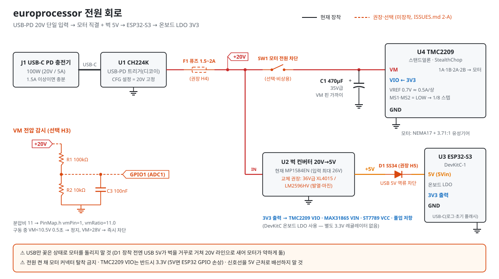
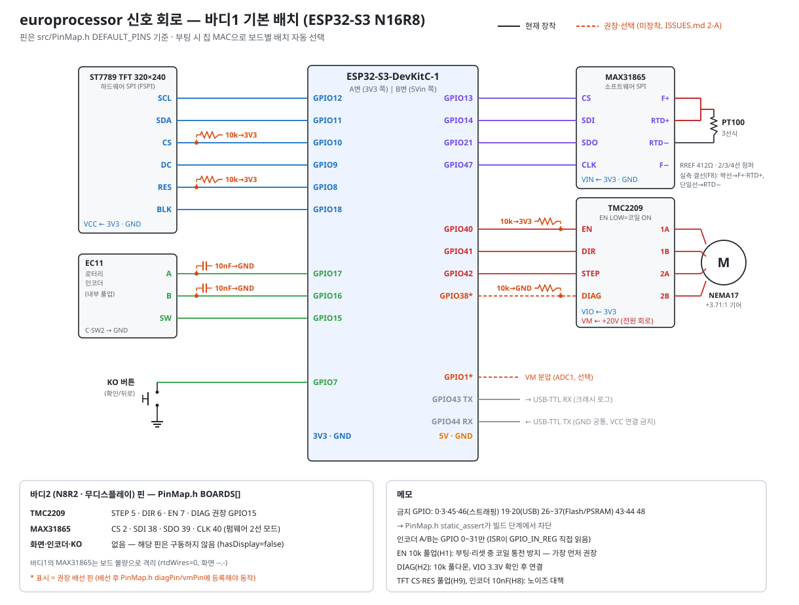

# europrocessor — 아날로그 필름 로터리 현상기

[](https://github.com/Moder4te/europrocessor/releases/latest)


ESP32-S3로 만든 **필름 현상 탱크 회전 교반기**입니다. 폰 웹 화면이나 본체 화면으로 레시피를 실행하면
탱크를 정/역 방향으로 부드럽게 돌리고, 단계가 끝날 때마다 약품 교체를 알려 줍니다.

| 📥 펌웨어 받기 | 🔌 회로도 | 📖 전체 설명서 | 🧾 현황·남은 작업 |
|---|---|---|---|
| [최신 릴리스](https://github.com/Moder4te/europrocessor/releases/latest) | [아래 회로도](#-회로도) | [`docs/manual.html`](docs/manual.html) | [`ISSUES.md`](ISSUES.md) |

**목차** — [간편 설명서](#-간편-설명서) · [회로도](#-회로도) · [하드웨어·부품](#-하드웨어--부품) · [펌웨어 업데이트·빌드](#-펌웨어-업데이트--빌드) · [기술 문서](#-기술-문서)

---

## 📘 간편 설명서

### ① 전원 켜기
1. 모터 케이블이 꽂혀 있는지 확인합니다 (**전원이 꺼진 상태에서만** 꽂고 뺍니다).
2. **USB-C PD 충전기(20V 지원, 1.5A 이상)** 를 본체에 꽂으면 바로 부팅합니다.
3. 재부팅 직후에도 **모터는 저절로 돌지 않습니다.**

### ② 폰으로 접속하기

| 순서 | 할 일 |
|---|---|
| 1 | 폰 WiFi에서 본체 AP에 연결 — 기본 이름 `europrocessor`, 비밀번호 `12345678` |
| 2 | 브라우저에서 **`http://<AP 이름>.local`** (예: `http://europrocessor.local`) |
| 3 | `.local`이 안 열리면 IP로: 보드 번호 1 → `192.168.4.1`, 2 → `192.168.5.1` … |
| 4 | 화면 아래 탭: **📋 레시피 · ▶️ 상태 · 🎛️ 수동 · ⚙️ 설정** |

> 💡 **현재 운용 구성**: 폰 → 바디2 AP `FilmProcessor` → `http://filmprocessor.local` (192.168.5.1) →
> ▶️ 상태 탭 **🔗 동시 제어**를 켜면 바디1도 같은 화면에서 함께 제어됩니다.

### ③ 레시피로 현상하기
1. **📋 레시피** 탭 → 분류(**B&W / C-41 / ECN-2 / E-6**) → 레시피 선택.
   처음이면 **[+ 추가]** → **[+ 단계 추가]** 로 단계마다 *이름 · 속도(RPM) · 시간(초) · 방향전환(초)* 입력.
2. **[▶ 실행]** → 1단계 시작. 2초에 걸쳐 부드럽게 가속하고, 정해진 주기마다 정/역을 바꿉니다(전환 사이 2초 휴지).
3. 단계 시간이 끝나면 감속 정지 후 **"✅ 단계 완료"** 창 → 약품 교체 → **[다음 단계 ▶]**.
4. 마지막 단계가 끝나면 **"🎉 레시피 완료!"**

**진행 중 조작 (▶️ 상태 탭)**

| 버튼 | 동작 |
|---|---|
| ⏸ 일시정지 / ▶ 재개 | 감속 정지 후 대기. 남은 시간은 그대로 보존 |
| ⏭ 단계 건너뛰기 | 감속 정지 후 다음 단계로 |
| 타임라인의 단계 누르기 | 그 단계로 이동 (확인창 → 감속 후 이동) |
| ⏹ 정지 | **비상정지** — 즉시 멈추고 레시피 종료 |

### ④ 수동 운전 (🎛️ 수동 탭)
속도(최대 80 RPM, **권장 75**) · 자동 방향 전환 · 방향당 운전 시간(초)을 정하고 **[▶ 순방향] / [◀ 역방향]** 으로 시작,
**[⏹ 정지]** 는 감속 정지입니다.

### ⑤ 본체 화면 조작 (바디1 — TFT + 다이얼)

| 조작 | 기능 |
|---|---|
| 다이얼 돌리기 | 커서 이동 / 값 조절 |
| 다이얼 누르기 (PUSH) | 선택·확정. 홈에서 누르면 메뉴(레시피 실행 중엔 일시정지·건너뛰기·정지 메뉴) |
| **OK 버튼** | 뒤로/취소. **홈에서는 상황별 바로가기**: 단계 완료 대기 → 다음 단계 · 레시피 중 → 일시정지/재개 · 수동 회전 중 → 안전정지 · 대기 중 → 수동 바로 시작 |

웹에서 저장한 레시피를 본체 메뉴(**Run recipe**)에서 바로 고르고 실행할 수 있습니다.

### ⑥ 여러 대 동시 제어
1. **추가할 보드**: ⚙️ 설정 → 홈 WiFi **[검색]** → 마스터 보드의 AP 선택 → 비밀번호 → **[저장 및 재시작]**
2. **폰**은 마스터 AP에 연결 → ▶️ 상태 탭 **🔗 동시 제어** 켜기 → **[보드 찾기]**
3. 이제 시작·정지·일시정지·다음 단계·수동 운전이 연결된 보드 전부에 같이 적용됩니다. 전달 실패한 보드는 알림이 뜹니다.

### ⑦ 정전·리셋이 났을 때
다시 켜도 모터는 돌지 않고, ▶️ 상태 탭 배너(본체 화면은 `RESUME?`)에서 고릅니다:
**[이어서 진행] · [이 단계 처음부터] · [다음 단계부터] · [취소]**. 이어서 진행의 경과 시간은 마지막 방향 전환 시점 기준 근사값입니다.

### ⑧ 펌웨어 업데이트 (OTA, 케이블 불필요)
1. [최신 릴리스](https://github.com/Moder4te/europrocessor/releases/latest)에서 **보드 사양에 맞는 파일**을 받습니다.

   | 보드 | 칩 | 파일 |
   |---|---|---|
   | 바디1 (화면 있음) | N16R8 | `firmware_vX.Y.Z_n16r8.bin` |
   | 바디2 (화면 없음) | N8R2 | `firmware_vX.Y.Z_n8r2.bin` |

2. **모터·레시피가 멈춘 상태**에서 ⚙️ 설정 → **펌웨어 업데이트** → 파일 선택 → **[업로드 후 재부팅]** → 약 10초 뒤 새로고침.
3. 사양이 다른 파일은 `wrong board variant`로 거부되고, 새 펌웨어가 부팅에 실패를 반복하면 **이전 펌웨어로 자동 복귀**합니다. 레시피는 유지됩니다.

### ⑨ 문제 해결

| 증상 | 원인 / 해결 |
|---|---|
| 주소가 안 열림 | `.local`을 못 푸는 기기 → IP(`192.168.4.1` / `5.1`)로 접속. 재부팅 직후엔 폰이 AP에 다시 붙기까지 1분 정도 걸림 |
| 저장 시 "motor running"(409) | 운전 중엔 플래시 쓰기 금지(모터 덜컹 방지). 정지 후 다시 저장 — 레시피 편집은 정지 후 자동 저장 |
| 모터가 안 돎 (⚙️ 설정 → 디바이스 정보 Guard `locked`) | 비정상 리셋 3회 연속 → 안전 잠금. **전원을 뽑았다 다시 꽂으면 해제** |
| "⚠ 하드웨어 고장 — 모터 잠김" (본체 `FAULT`) | 드라이버 과열·전원 이상 감지(감시 핀 배선 시). 원인 점검 후 상태 탭 **[점검 후 해제]** |
| 본체 다이얼이 3초간 먹통 | 노이즈 가드(인코더 잡음 감지) — 자동 해제. 반복되면 모터가 감속 정지/일시정지 |
| 온도가 `--.-` / `FAULT` | 바디1은 센서 보드 불량으로 격리 중. 바디2는 ⚙️ 설정 → 온도 보정 카드의 `FAULT (코드)` 확인 → [`manual.html`](docs/manual.html) 트러블슈팅 |
| 80 RPM 이상에서 덜컹·탈조 | 모터 토크 한계. **75 RPM 권장** |
| USB만 꽂았는데 모터가 약하게 돎 | USB 5V가 거꾸로 새는 현상 → 20V 전원 없이 모터 쓰지 않기 (쇼트키 D1 권장) |
| PC 시리얼 모니터를 닫았더니 재부팅 | USB 시리얼 특성. 운전 중엔 닫거나 뽑지 않기 (`--dtr 0 --rts 0`) |

> ⚠ **안전 수칙** — 전원 켠 채 모터 커넥터 탈착 금지 · USB만으로 모터 구동 금지 · 급할 땐 웹 **⏹ 정지** · AP 기본 비밀번호 `12345678`은 설정에서 변경

---

## 🔌 회로도

> 실선 = 현재 장착, **주황 점선 = 권장·선택 부품(아직 미장착)** — 작업 목록은 [`ISSUES.md` 2-A](ISSUES.md#2-a-하드웨어-직접-작업--펌웨어는-준비-완료).
> 회로도는 [`tools/gen_schematic.py`](tools/gen_schematic.py)로 생성합니다(핀을 바꾸면 값 수정 후 재실행).

### 전원 회로
[](docs/schematic_power.svg)

텍스트 요약 (`*` = 권장·선택 부품):

```
USB-C PD ──> CH224K (20V) ──> [F1 fuse 1.5-2A*] ──┬──> [SW1*] ──> TMC2209 VM (+ C1 470uF) ──> NEMA17
                                                  │
                                                  └──> buck 20V->5V ──> [D1 SS34*] ──> ESP32-S3 5V
                                                                                         │ onboard LDO
                                                                                         └──> 3V3: TMC VIO, MAX31865, TFT, pull-ups
```

### 신호 회로 (바디1 기본 배치)
[](docs/schematic_signal.svg)

### 핀 배정 표

| 장치 | 신호 | 바디1 (N16R8, 기본) | 바디2 (N8R2, 무디스플레이) |
|---|---|---|---|
| **TMC2209** | STEP / DIR / EN | GPIO 42 / 41 / 40 | GPIO 5 / 6 / 7 |
| | DIAG (권장, 10kΩ 풀다운) | GPIO 38 | GPIO 15 |
| **MAX31865** | CS / SDI / SDO / CLK | GPIO 13 / 14 / 21 / 47 | GPIO 2 / 38 / 39 / 40 |
| | 결선 모드 (`rtdWires`) | 0 = 격리 (보드 불량) | 2선 모드 |
| **ST7789 TFT** | SCL / SDA / CS / DC / RES / BLK | GPIO 12 / 11 / 10 / 9 / 8 / 18 | — |
| **EC11 인코더** | A / B / PUSH | GPIO 17 / 16 / 15 | — |
| **KO 버튼** | 확인/뒤로 | GPIO 7 | — |
| VM 감시 (선택) | 100k/10k 분압 → ADC1 | GPIO 1 | GPIO 1 |
| UART0 로그 | TX / RX → USB-TTL | GPIO 43 / 44 | GPIO 43 / 44 |

- 핀은 **`src/PinMap.h` 한 곳**에서 관리하고, 부팅 시 **칩 MAC으로 보드를 알아보고 배치를 자동 선택**합니다(미등록 보드는 기본 배치). 같은 `.bin`을 어느 보드에 올려도 안전합니다.
- 금지 GPIO(0·3·45·46 스트래핑, 19·20 USB, 26~37 Flash/PSRAM, 43·44 UART0, 48 RGB LED)·중복 핀·인코더 핀 ≥32는 **빌드 단계에서 `static_assert`로 차단**됩니다.
- 새 보드 등록: 웹 설정의 MAC 확인 → `BOARDS[]`에 한 줄 추가 → 빌드·OTA. DIAG·VM 감시 핀은 배선 후 `diagPin`/`vmPin`/`vmRatio`에 등록해야 동작합니다.

| 보드 | MAC | 사양 |
|---|---|---|
| 바디1 | `A0:F2:62:E5:D9:B0` | N16R8, 디스플레이, 온도센서 격리 |
| 바디2 | `D0:CF:13:59:14:78` | N8R2, 무디스플레이, PT100 2선 모드 |

---

## 🧰 하드웨어 · 부품

| 구분 | 부품 | 사양 / 설정 |
|---|---|---|
| MCU | ESP32-S3-DevKitC-1 | N16R8(16MB / 8MB OPI PSRAM) 또는 N8R2(8MB / 2MB QSPI PSRAM) |
| 모터 | NEMA17 + 3.71:1 유성기어 | 1.8°(200 step/rev), 정격 1.3A/상 |
| 드라이버 | TMC2209 모듈 (스탠드얼론) | STEP/DIR/EN, StealthChop, **1/8 마이크로스텝(MS1·MS2 LOW)** → 1600 step/rev, VREF 0.7V ≈ 0.5A |
| 온도 | MAX31865 + PT100 | 3선식, RREF 412Ω(실측) / R0 100Ω, 측정·보정만(히터 제어 없음) |
| 화면 | ST7789 320×240 SPI TFT | 바디1만, 색반전 보정 `invertDisplay(false)` |
| 입력 | EC11 로터리 인코더 + 푸시버튼(KO) | 바디1만, 내부 풀업 |
| 전원 | USB-C PD 충전기 + CH224K 트리거 | 20V 고정. 소비 1A 미만 → 20V 1.5A 이상이면 충분 |
| 강압 | 벅 컨버터 20V→5V | 현재 MP1584EN, **36V급(XL4015 / LM2596HV) 교체 권장** |
| 벌크 | 전해 커패시터 470µF | 20V 레일, 드라이버 VM 근처 |
| 권장 추가 | 퓨즈 1.5~2A · SS34 · 10kΩ×4 · 10nF×2 · 100kΩ/10kΩ/100nF | [`ISSUES.md` 2-A](ISSUES.md) H1~H10 |

**속도 계산** — 출력축 RPM × 3.71 = 모터 RPM → step/s. 최대 80 RPM = 모터 297 RPM = **7,915 step/s**(`MAX_SPEED`).
80 RPM 초과 탈조는 코드 결함이 아니라 토크–속도 한계(back-EMF)이며, 권장 운전은 75 RPM입니다.

**교반 시나리오** — 정방향 `rotIntSec` 구동 → S-커브 감속 정지 → **REST 2초(EN=HIGH, 코일 전류 차단 = 관성 안정 + 발열 억제)** → 역방향 → … 반복.
REST는 감속이 완전히 끝난 뒤(`!isRunning()`) 시작하므로 2초는 순수 휴식 구간입니다.

**냉각·열 검증** — 모터는 수면 아래 PETG 벽 밀착 + 38°C 수조(세미 수랭), 전자부는 물 위 공냉. 75 RPM 연속 2시간+ → 모터·전자부 ≈50°C(PETG Tg 80°C 대비 30°C 마진).

---

## 🔄 펌웨어 업데이트 · 빌드

**칩 사양이 2종이라 빌드 환경도 2개**입니다(플래시 용량·PSRAM 종류는 빌드 타임 설정).

| 환경 | 칩 | 파티션 | 대상 |
|---|---|---|---|
| `esp32-s3-devkitc-1` | N16R8 | `partitions.csv` — 3MB APP ×2(OTA) + 9.9MB LittleFS | 바디1 |
| `n8r2` | N8R2 | `partitions_8MB.csv` — 3MB APP ×2 + 1.9MB LittleFS | 바디2 |

```bash
pio run -e esp32-s3-devkitc-1 -e n8r2               # 두 사양 모두 빌드 (둘 다 통과해야 함)
pio run -e n8r2 -t upload --upload-port COMx        # USB 업로드 (최초 1회 또는 파티션 변경 시)
pio device monitor --dtr 0 --rts 0                  # 시리얼 모니터 — ★DTR/RTS 끄기★
```

- **OTA(권장)**: 웹 설정 → 펌웨어 업데이트에 `.pio/build/<환경>/firmware.bin` 또는 릴리스의 `.bin` 업로드.
  명령줄: `curl -H "X-OTA: 1" -F "firmware=@firmware.bin" http://<보드>/api/ota`
- 릴리스에는 OTA용 `.bin`과 크래시 백트레이스 해석용 `.elf`(같은 빌드), `SHA256SUMS.txt`가 함께 올라갑니다.
- **⚠ USB 시리얼 포트를 닫으면 보드가 리셋**됩니다(USB-Serial-JTAG). 크래시 로그는 UART0(GPIO43/44) TTL로 받는 게 안전합니다.
  백트레이스: `xtensa-esp32s3-elf-addr2line -pfiaC -e firmware.elf <주소…>`
- `data/` 폴더가 없으므로 `uploadfs`는 불필요합니다(레시피·화면보호기는 런타임 생성). `firmware/`, `backups/`는 git 제외.
- 라이브러리는 `platformio.ini`의 `lib_deps`에 **버전 고정**(ArduinoJson 7.4.3, FastAccelStepper 1.2.5, ESPAsyncWebServer 3.6.0 등).

| 빌드 플래그 | 의미 |
|---|---|
| `UI_DISPLAY_PRESENT=1` | 화면 코드 포함. 보드별 화면 유무는 `PinMap.h` `hasDisplay`로 런타임 결정 |
| `FW_VARIANT` | 칩 사양 태그(`N16R8`/`N8R2`) — 웹·로그 표시 |
| `BOARD_HAS_PSRAM` + `memory_type` | N16R8 `qio_opi` / N8R2 `qio_qspi` |
| `ARDUINO_USB_CDC_ON_BOOT=1` | 네이티브 USB 포트로 Serial 출력 |
| `CORE_DEBUG_LEVEL=0` | 코어 로그 억제(디버깅 시 3) |

**도구 (`tools/`)** — `gen_schematic.py`(회로도 SVG 생성, 표준 라이브러리만) · `gen_nyan.py`(GIF → `src/nyan_frames.h` RGB565 프레임, Pillow 필요) · 진단용 `.ino` 스케치(빌드 대상 아님).

---

## 📚 기술 문서

각 항목을 눌러 펼치세요. 더 자세한 내용(상태머신 그림·크래시 분석·설정 상수 전체)은 [`docs/manual.html`](docs/manual.html).

<details>
<summary><b>아키텍처 — 듀얼코어 분리 · 크로스코어 동기화 · 모듈 구성</b></summary>

### 듀얼코어 분리
시간 크리티컬한 모터 제어와 비차단 통신/UI를 코어로 분리합니다.

| 코어 | 담당 |
|---|---|
| **Core 1** (`loop()`) | 모터 상태머신 + 레시피 타이밍. FastAccelStepper 하드웨어 ISR이 스텝 펄스를 독립 생성 |
| **Core 0** | WiFi 스택 + AsyncWebServer + `tempTask`(온도 1Hz) + `displayTask`(UI 25Hz) + `dnsTask` |

**핵심 규약**: 웹 핸들러·디스플레이(Core 0)는 모터/레시피 상태를 **직접 건드리지 않습니다.**
모든 조작은 `CommandQueue`로 enqueue → Core 1의 `loop()`이 dispatch하여 단일 코어에서만 상태를 변경합니다.

### 크로스코어 동기화
- **CommandQueue** — 일반 명령(시작/정지/일시정지/확인/수동)을 직렬 전달
- **비상정지 플래그** — 큐가 가득 차도 유실되면 안 되므로 큐를 우회하는 `volatile` 플래그
- **레시피 스테이징** — `/api/start`는 뮤텍스 보호 버퍼에 적재만 하고, `loop()`이 안전한 시점에 꺼내 적용
- **뮤텍스** — 온도 스냅샷, 레시피 `steps` 벡터, 스테이징 버퍼 각각 보호

### 모듈 구성 (`src/`)
```
main.cpp              App 코디네이터 — 객체 소유·배선, setup/loop, 상태 전이
Config.h              물리 상수 (Cfg::, constexpr) · FW_VERSION · 노이즈/온도/감시 임계값
PinMap.*              보드별 핀 배치 + hasDisplay + rtdWires + 감시 핀 (칩 MAC 자동 선택, static_assert 검증)
NoiseGuard.*          입력 노이즈 버스트 감시 → 패널 입력 차단/모터 정지, 연속 비정상 리셋 시 모터 잠금
HwSafety.*            TMC2209 DIAG / 모터 전원 VM 감시 → 즉시 차단·잠금 (배선된 보드만)
Types.h               공유 도메인 타입 (MotorState, StepInfo, CmdType, Cmd)
CommandQueue.h        크로스코어 명령 큐 + 비상정지 플래그
RecipeStage.h         레시피 스테이징 버퍼 (Core 0 → Core 1)
ISaver.h              화면보호기 설정 인터페이스 (+ 무디스플레이용 NullSaver)
MotionController.*    TMC2209 스테퍼 상태머신 (레시피 무관)
RecipeRunner.*        레시피 단계 시퀀서 + 정전 복구 기록 (steps + 뮤텍스 소유)
TemperatureSensor.*   MAX31865 — Core 0 태스크, 뮤텍스 보호, 선형 보정
WifiManager.*         AP(+STA, 항상 DHCP), AP 이름=mDNS 이름, 자체 DNS 태스크, Preferences
WebServer.*           ESPAsyncWebServer 라우트 + 상태 JSON + 스테이징 + OTA
web_assets.h          웹 UI HTML/CSS/JS (PROGMEM 임베드, 한/영)
web_multi.h           (구) 멀티 보드 페이지 /multi — IP 수동 입력 (집 공유기 공유 구성용)
DisplayUI.*           ST7789 + 인코더 + 버튼 UI (Core 0 태스크, ISaver 구현)
```
</details>

<details>
<summary><b>모듈 상세 — main · MotionController · RecipeRunner · TemperatureSensor · WifiManager · WebServer · DisplayUI</b></summary>

### `main.cpp` — App 코디네이터
모든 서브시스템 객체를 소유하고 참조를 주입해 배선합니다. 시스템 상태 전이는 여기에 집약됩니다.
- `stopAll()` 비상정지(모터 즉시 정지 + 레시피 초기화 + 모드 리셋) · `safeStop()` 가속도 곡선 감속 후 정지 · `manualStart()` 수동 운전
- `dispatch()` 큐 명령 분기 · `setup()` 부팅 핀 안전 고정 → 서브시스템 초기화 → 태스크 기동
- `loop()` 비상정지 확인 → 노이즈/하드웨어 감시 → 명령 dispatch → 레시피 스테이징 적용 → WiFi/모터/레시피 업데이트

### `MotionController` — 모터 상태머신
FastAccelStepper로 펄스를 생성하고 EN 핀은 수동 제어(REST 구간 코일 차단)합니다. **레시피를 모릅니다** —
단계 종료는 `requestStepStop()`으로 받고, 감속 완료는 `takeStepStopped()` 이벤트로 알립니다.
상태: `IDLE → RUN_FWD → STOP_FWD → REST → RUN_REV → STOP_REV → REST → …`, 레시피 단계 종료 `STOP_RECIPE`, 안전 정지 `STOP_SAFE`.
S-커브 소프트스타트: 목표속도 기준 매 구동 `a = v·(1+f)/T`, `s_h = f²·v·T / (1.5·(1+f))` (`RAMP_SEC` 2.0, `SCURVE_HANDOVER` 0.5).

### `RecipeRunner` — 레시피 시퀀서
`steps` 벡터를 뮤텍스로 보호(웹 `buildStatus`가 Core 0에서 동시 읽기)하며, 모터는 `MotionController` 경유로만 구동합니다.
`load()` → `startStep(0)` → 지속시간 경과 시 `requestStepStop()` → 감속 완료 → `waitConfirm`(약품 교체 대기) → `confirm()` → 다음 단계.
진행 상태를 NVS `rec`에 **모터가 멈춘 순간에만** 기록해 정전 복구에 씁니다.

### `TemperatureSensor` — 온도 측정
Core 0 전용 태스크에서 MAX31865를 1Hz 폴링(소프트웨어 SPI). fault는 즉시 clear하지 않고 **연속 5회 누적 후에만** 시도.
- **결선 모드**: 보드별 `rtdWires`(2/3/4) — 보드 솔더점퍼와 일치 필수. `0`이면 init·태스크 미생성(화면 `--.-`).
- **진단**: 부팅 시 threshold 레지스터 SPI 라운드트립 자가진단 + fault 비트 디코드 + raw RTD 출력.
- **오류 판정**: SPI 미통신(0x01), 유효범위(-20~100°C) 밖(0x02). 1초에 2°C 넘는 점프는 스파이크로 버림.
- **보정**: `R = gain·R_meas + offset`(NVS `tcal`). 웹 설정 "온도 보정"에서 1점/2점(예: 0°C 얼음물 + 38°C).

### `WifiManager` — 네트워크
홈 WiFi(STA) 미설정이면 AP 단독, 설정 시 AP+STA(**항상 DHCP**).
- **AP 이름 = 접속 주소**: SSID를 mDNS 호스트 이름으로 씀 → `http://이름.local`. 새 SSID는 영문 소문자·숫자·`-`, 1~32자.
- **자체 DNS(Core 0)**: 자기 이름 → AP IP, 연결된 다른 보드 이름 → mDNS 대리 응답(60초 캐시), 그 외 NXDOMAIN — `.local`을 못 푸는 안드로이드도 이름으로 접속.
- **보드 번호(1~9)**: AP 대역 `192.168.(3+N).1`. AP 최대 접속 10. STA 재연결 백오프 30s→최대 5분, WiFi 절전 OFF.

### `WebServer` — HTTP
ESPAsyncWebServer 기반, 의존성은 `begin()`에서 주입. 대용량 JSON(`/api/start`, 레시피 저장)은 청크 분할 수신 + 요청별 버퍼로 힙 단편화를 억제합니다.

### `DisplayUI` — 물리 UI
ST7789 + EC11 + KO 버튼, U8g2 한글 폰트, 캐시 기반 부분 렌더링. 페이지: STATUS / 메뉴 / RUN CONTROL / 레시피 분류·목록·미리보기 / 수동 / 설정 / 정보 / 화면보호기.
- **화면보호기**: 브라우저가 GIF를 160×120 RGB565 `ANM1`로 트랜스코드(최대 8프레임) → 기기는 디코드 없이 2× blit. 우선순위 `/saver.anim` > `/saver.jpg` > 임베드 Nyan.
- **IRAM-safe 인코더**: IDF GPIO ISR 서비스(`ESP_INTR_FLAG_IRAM`) + `REG_READ`·`DRAM_ATTR` 테이블. 여기에 더해 **모터 비-IDLE이면 모든 플래시op 금지**로 "Cache disabled" 패닉을 차단합니다(PCNT 인코더는 FastAccelStepper가 PCNT를 점유해 불가).
</details>

<details>
<summary><b>웹 API</b></summary>

| 메서드 | 경로 | 설명 |
|---|---|---|
| GET | `/` | 웹 UI |
| GET | `/api/status` | 모터/레시피/온도/네트워크/진단 상태 JSON |
| POST | `/api/start` | 레시피 시작 (steps 배열, 청크 수신 → 스테이징) |
| POST | `/api/stop` | 비상정지 (큐 우회 플래그) |
| POST | `/api/pause` · `/api/confirm` | 일시정지/재개 토글 · 다음 단계 확인 |
| POST | `/api/skip` · `/api/safestop` | 단계 건너뛰기 / 감속 정지 (둘 다 감속 후 동작) |
| POST | `/api/goto` | `{"step":N}` 지정 단계로 이동 |
| GET | `/api/recipe` | 실행 중 레시피의 단계 목록(이름·시간·RPM) |
| POST | `/api/manual` | 수동 운전 (속도/방향/사이클/주기) |
| GET·POST | `/api/settings` | WiFi 설정 조회/저장(저장 시 재부팅) |
| GET·POST | `/api/recipes/load`·`/save` | 레시피 JSON 불러오기/저장(LittleFS, 원자적 교체, 64KB 상한) |
| GET·POST | `/api/saver/settings` | 화면보호기 활성/타임아웃 |
| POST·DELETE | `/api/saver/image` | 화면보호기 업로드(매직바이트로 JPEG/GIF/`ANM1` 판정)/삭제 |
| GET | `/api/wifi/scan` | 주변 WiFi 비동기 검색(`?refresh=1` 강제) |
| POST | `/api/temp/cal` | 온도 보정 `{"gain","offset"}` 또는 `{"reset":true}` |
| GET | `/api/peers` | 이 보드 AP에 접속한 기기 IP 목록 (동시 제어 자동 탐색) |
| POST | `/api/recovery` | 정전 복구 `{"action":"resume"\|"restart"\|"next"\|"discard"}` |
| POST | `/api/hwfault/clear` | 하드웨어 고장 해제 (원인이 사라졌을 때만) |
| POST | `/api/ota` | 펌웨어 업로드(`X-OTA` 헤더 필수). 사양 불일치·운전 중·동시 업로드 거부, 크래시 루프 시 자동 롤백 |
| GET | `/multi` | (구) 멀티 보드 페이지 — IP 수동 입력 |

`/api/status` 진단 키: `fw`·`variant`·`name`·`boardId`·`mac`·`pinProfile`·`upSec`·`heapFree/Min/Max`·`guard`·`resetReason`·`rssi`·`apClients`·`tempFaultCode`·`rtdWires`·`rtdOhm`·`calGain/calOffset`·`hwFault`·`vm`·`recovery`.

**운전 중 차단**: 모터 회전·감속 중이거나 레시피 진행(일시정지·확인대기 포함) 중이면 플래시 쓰기·재부팅이 따르는 요청(설정 저장, 레시피 저장, 화면보호기, OTA, 온도 보정)은 모두 **409**.
</details>

<details>
<summary><b>안전 설계 — 물리 손상 방지</b></summary>

- **부팅 즉시 TMC2209 EN=HIGH** — 리셋~setup 구간 floating으로 코일이 통전된 채 정지 → 발열/소손 방지. 권장 HW 풀업: EN→3.3V 10kΩ.
- **부팅 즉시 패널 신호 핀 idle 고정** — floating noise로 패널 컨트롤러가 비정상 state에 빠지는 것 방지. 권장 HW 풀업: TFT CS·RST→3.3V 10kΩ.
- **디스플레이 배선 주의** — 신호선을 5V 근처로 라우팅하지 말 것. 5V가 신호핀에 닿으면 ESD 다이오드로 VCC 레일에 역주입되어 손상(실사례).
- **PCNT 패닉 회피** — IDF 4.4 pcnt 드라이버가 객체를 PSRAM에 잡아 모터 운전 중 플래시 접근 시 패닉(reset 4). FAS 초기화 동안 PSRAM을 점유해 내부 RAM 할당 강제.
- **운전 중 플래시 쓰기·재부팅 금지** — 플래시 소거 중 펄스 큐 보충이 멈춰 덜컹일 수 있음. 웹 409 + NVS 쓰기 지연.
- **노이즈 가드** — 인코더/버튼 노이즈 버스트 → 패널 입력 3초 차단, 60초 내 3회 → 모터 정지(레시피는 일시정지). 연속 비정상 리셋 3회 → 모터 잠금(전원 재투입 해제).
- **감속 정지** — 일시정지·단계 이동·건너뛰기는 S-커브 감속 후 동작. 비상정지만 즉시.
- **정전·리셋 복구** — 재부팅 후 모터 자동 구동 없음. 사용자가 이어서/단계 처음부터/다음 단계/취소 선택.
- **하드웨어 감시 (`HwSafety`)** — 배선·등록 시: DIAG HIGH 60ms → 코일 즉시 차단, 구동 중 VM<10.5V 0.5초 → 정지, VM>28V → 즉시 차단. 레시피는 일시정지로 보존.
- **OTA 안전망** — 사양 불일치 이미지 거부, 새 펌웨어가 크래시 루프면 이전 파티션으로 자동 롤백, 60초 정상 가동 후 확정.
- **전원** — 20V 퓨즈 1.5~2A, VM 근처 100~470µF, 5V 출력 쇼트키(USB 역류 방지) 권장. 전원 켠 채 모터 커넥터 탈착 금지.
</details>

---

## 라이선스 / 작성

개인 프로젝트(직접 제작·유지보수). 목표는 회전 전용 로터리 현상기(타쿠미 아이스크림급) 구매가 이하로 더 고스펙인 기기를 자작하는 것입니다.
펌웨어는 Arduino-ESP32 + PlatformIO 환경에서 빌드하며, 필요한 라이브러리는 `platformio.ini`의 `lib_deps`에 명시되어 자동 설치됩니다.
